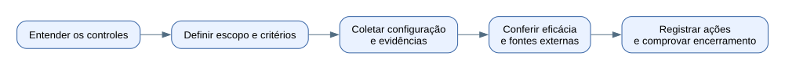

# Projeto de auditoria AWS e Kubernetes

Material para entender os controles, discutir a arquitetura e reunir evidências de auditoria. Reúne as explicações discutidas, diagramas, o kit de consultas de leitura e o guia de hardening para Confluence.

## Comece pela sua necessidade

| Preciso… | Abra |
|---|---|
| Entender os itens que o auditor pediu | [Os 21 controles explicados](docs/01-controles-da-auditoria.md) |
| Explicar CSI Driver, Secrets Manager, IAM e rotação | [Identidades e segredos](docs/02-identidades-segredos-e-rotacao.md) |
| Entender onde entra o CertFlow | [Certificados e CertFlow](docs/03-certificados-e-certflow.md) |
| Saber o que mostrar e como responder | [Evidências e conversa com o auditor](docs/04-evidencias-e-respostas.md) |
| Registrar e acompanhar o que falta | [Plano de ação](docs/05-plano-de-acao.md) |
| Executar as consultas no computador de trabalho | [Runbook do kit](toolkit/RUNBOOK.md) ou [HTML local](toolkit/RUNBOOK.html) |
| Preparar o guia interno de hardening | [Guia Confluence](toolkit/CONFLUENCE-HARDENING.md) ou [HTML para copiar](toolkit/CONFLUENCE-HARDENING.html) |
| Conferir origem, validação e limites | [Fontes e situação](docs/FONTES.md) e [validação do kit](toolkit/VALIDACAO.md) |

## Entenda o projeto antes de executar



A documentação tem três tipos de informação claramente identificados: **cenário informado pelo usuário**, **desenho encontrado no acervo** e **funcionamento técnico de referência**. Nenhum deles substitui evidência medida do ambiente.

O usuário informou em 11/11/2026 que usa CSI Driver integrado ao Secrets Manager, com IAM para controle de acesso. Ainda não foram conferidos o mecanismo de identidade do workload, a configuração de atualização do CSI ou a adoção do segredo novo pela aplicação. Os scripts não foram executados pelo usuário no ambiente de trabalho até o relato desta data.

## Estrutura

```text
README.md                  ponto de entrada e roteiro por necessidade
docs/                      conceitos, arquitetura e orientação de auditoria
  diagramas/               diagramas SVG e suas fontes editáveis DOT
  referencias/             documentos recuperados do CertFlow
toolkit/                   pacote executável existente, preservado
  auditlib/                coletores, evidência e regras observacionais
  tests/                   testes locais
  examples/                referências de permissões e evidência externa
```

## Executar o kit

No terminal, entre em `toolkit/` e siga seu runbook. O comando de verificação local é:

```bash
cd toolkit
python3 package_audit.py --verify .
python3 -m unittest discover -s tests -v
```

Windows: use `py -3` no lugar de `python3`. Nenhuma dessas verificações consulta uma conta AWS. As consultas reais precisam da sessão e do escopo corporativos autorizados.

## Evidências e publicação

Os resultados reais ficam fora do conteúdo versionado. O `.gitignore` reduz inclusão acidental, mas não substitui revisão dos arquivos antes do envio. Não incluir senhas, tokens, credenciais, dados pessoais ou resultados corporativos no repositório público. O kit utiliza nomes fictícios nos exemplos.

Este diretório está preparado localmente; o destino GitHub ainda será fornecido pelo usuário. O guia de hardening é proposta técnica e requer aprovação interna antes de ser tratado como baseline vigente. O projeto não declara conformidade nem substitui os processos existentes.
