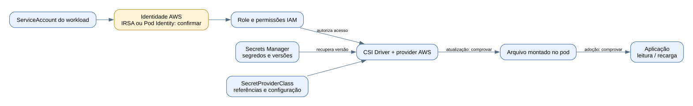

# Kubernetes: identidades, segredos e rotação

**Cenário informado pelo usuário em 11/11/2026:** CSI Driver integrado ao AWS Secrets Manager, com IAM para controlar acesso. O usuário reconheceu o desenho abaixo como representativo da arquitetura. O modo de identidade, os parâmetros do driver e o comportamento real de recarga não foram medidos nesta preparação.

## O papel de cada peça

| Peça | O que faz | O que não demonstra sozinha |
|---|---|---|
| ServiceAccount | Identifica o workload perante Kubernetes e participa da integração de identidade AWS quando configurada. | Que a aplicação tem as permissões corretas ou que usa credenciais temporárias. |
| IRSA ou EKS Pod Identity | Vincula a identidade do workload a uma role e permite obter credenciais temporárias, conforme configuração e SDK compatível. | Qual dessas opções é usada neste ambiente: ainda a confirmar. |
| Role e políticas IAM | Autorizam ações nos segredos e, quando aplicável, uso da chave KMS correspondente. | Rotação da senha ou permissões RBAC Kubernetes. |
| Secrets Manager | Armazena segredos/versionamento e oferece mecanismos de rotação configuráveis. | Que a rotação está habilitada, funciona no sistema de destino e chega à aplicação. |
| SecretProviderClass | Recurso que configura o provider e quais objetos externos serão apresentados ao workload. | O valor do segredo ou a execução da rotação na origem. |
| CSI Driver + provider AWS | Recuperam e apresentam os segredos como arquivos montados no pod. | Que atualização automática foi habilitada ou que a aplicação releu o arquivo. |
| Aplicação | Lê a credencial e a usa na conexão/autenticação. | Que passa a usar o novo valor apenas porque o arquivo foi atualizado. |

## São quatro ciclos de vida diferentes

| Objeto | Finalidade | Comprovação |
|---|---|---|
| Senha/token da aplicação | Acesso a banco ou serviço externo. | Atualização no destino, nova versão no Secrets Manager, entrega e adoção pela aplicação. |
| Credencial AWS temporária do workload | Acesso aos serviços AWS. | Role, mecanismo de identidade, permissões e renovação pelo SDK compatível. |
| Token de ServiceAccount Kubernetes | Acesso à API Kubernetes. | Uso de token projetado com validade/renovação e RBAC adequado, quando esse acesso é necessário. |
| Chave de criptografia | Proteção criptográfica dos dados. | Política e ciclo de vida da chave. Trocar chave não equivale a trocar a senha armazenada. |

## Rotação ponta a ponta, passo a passo

1. **Origem:** o mecanismo de rotação atualiza a credencial no banco/serviço e no Secrets Manager. O CSI não realiza essa troca por conta própria.
2. **Distribuição:** o driver/provider, com atualização automática devidamente configurada e suportada, obtém a versão nova e atualiza a montagem.
3. **Consumo:** a aplicação percebe a mudança e renova seu uso da credencial, incluindo conexões quando necessário.
4. **Comprovação:** relacionar evento/resultado da rotação, versão montada e evidência de uso correto, sem revelar o segredo.

Se a aplicação usa arquivo, precisa relê-lo ou ter mecanismo de recarga. Se houver sincronização para Kubernetes Secret e uso como variável de ambiente, o processo em execução não recebe o valor novo apenas porque o Secret mudou; precisa de recriação/reinício controlado do consumidor. Não assumir que todos os consumidores usam o mesmo mecanismo.

## O que perguntar na reunião

| Pergunta | Onde buscar a resposta |
|---|---|
| Qual identidade/role o workload usa? | ServiceAccount, configuração IRSA/Pod Identity, trust policy e políticas IAM. |
| Quais segredos ele pode acessar? | Objetos referenciados e políticas; conferir menor privilégio. |
| Como o segredo é entregue? | SecretProviderClass, volume CSI e configuração do workload. |
| A atualização automática está ativa? | Instalação/configuração e versão do CSI/provider; comportamento depende da versão. |
| Qual versão chegou ao pod? | SecretProviderClassPodStatus e observabilidade do driver, quando disponíveis. |
| Como a aplicação adota a mudança? | Código/configuração de recarga e teste autorizado. |
| O que acontece em falha? | Alertas, retries, tratamento de credencial antiga e procedimento operacional. |

O kit atual coleta metadados de Secrets Manager e objetos gerais de Kubernetes. **Ele não coleta SecretProviderClass/SecretProviderClassPodStatus, não inspeciona todos os parâmetros do driver e não testa uma rotação.** Esses itens precisam de evidência complementar; não declarar que os scripts já comprovam esse fluxo inteiro.

## Como explicar ao auditor

> Utilizamos CSI Driver integrado ao Secrets Manager para disponibilizar segredos aos workloads, com autorização IAM. Para comprovar a rotação ponta a ponta, precisamos correlacionar a atualização na origem, a versão entregue ao pod e a adoção pela aplicação. O mecanismo de identidade e o menor privilégio também fazem parte da verificação.

## Referências técnicas

- [AWS — Secrets Manager com EKS](https://docs.aws.amazon.com/eks/latest/userguide/manage-secrets.html).
- [CSI Driver — atualização automática e versões montadas](https://secrets-store-csi-driver.sigs.k8s.io/topics/secret-auto-rotation).
- [AWS — identidade e acesso no EKS](https://docs.aws.amazon.com/eks/latest/best-practices/identity-and-access-management.html).
- [Kubernetes — ServiceAccounts](https://kubernetes.io/docs/concepts/security/service-accounts/).
- [AWS — rotação na origem](https://docs.aws.amazon.com/secretsmanager/latest/userguide/rotate-secrets_turn-on-for-other.html).

[Próxima leitura: certificados e CertFlow](03-certificados-e-certflow.md).
