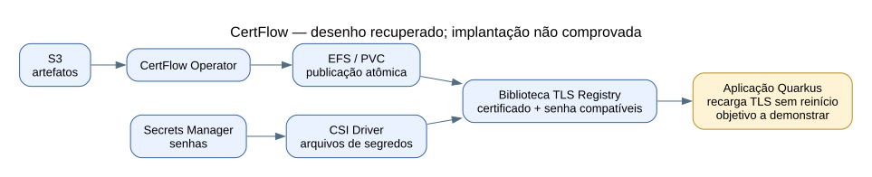

# Certificados e CertFlow

**Origem desta visão:** documentos de arquitetura, requisitos e escopo recuperados do acervo. Eles descrevem uma solução; não são recibos de implantação ou testes de rotação. A relação com uma iniciativa chamada “Cert Automation” não foi confirmada. Para esta última, foi encontrada apenas uma ficha de planejamento sem escopo técnico.

## O problema que o desenho procura resolver

Aplicações Quarkus precisam receber certificados/keystores/truststores e suas senhas de maneira coordenada, com atualização do contexto TLS sem reiniciar o pod. O desenho separa os artefatos das senhas que os protegem.

| Componente | Papel documentado |
|---|---|
| S3 | Origem dos artefatos de certificados. |
| CertFlow Operator | Detecta nova versão por polling/eventos e materializa o artefato no EFS. |
| EFS / PVC | Disponibiliza os arquivos aos consumidores. |
| Secrets Manager | Armazena as senhas dos artefatos. |
| CSI Driver | Entrega as senhas como arquivos, em caminho separado dos certificados. |
| Biblioteca TLS Registry da aplicação | Observa mudanças e recria o contexto TLS com certificado e senha correspondentes. |

A escrita atômica descrita usa uma versão temporária e a troca por rename/symlink. Seu objetivo é impedir que a aplicação leia um arquivo parcialmente escrito. Ela **não garante, por si só, consistência entre dois sistemas diferentes**, como o artefato do S3 e a senha do Secrets Manager.

## Como isso se relaciona à auditoria

- **Proteção de segredos:** separar artefatos e senhas e limitar acesso por identidade.
- **Acesso:** os requisitos preveem roles distintas para operator e aplicação; confirmar permissões efetivas.
- **Integridade/distribuição:** demonstrar escrita/publicação e associação de versão.
- **Continuidade:** o objetivo é recarga TLS sem reinício; comprovar comportamento e falhas.
- **Auditoria:** o requisito de rastrear operações precisa ser comprovado pela configuração de logs aplicável, não apenas pela presença do CloudTrail.

## O que ainda precisa de evidência

| Verificação | Por que importa |
|---|---|
| Onde está implantado e quais aplicações usam? | Define a cobertura real. |
| Artefato e senha têm vínculo de versão? | Evita ativar um certificado com senha incompatível. |
| Mudança só da senha dispara a recarga? | O texto recuperado detalha observação do diretório de certificados, mas não resolve completamente esse caso. |
| Uma conexão nova usa o certificado atualizado? | Arquivo modificado não comprova mudança do contexto TLS efetivo. |
| O que acontece em falha de S3/Secrets Manager, credencial inválida ou certificado expirado? | A especificação prevê resiliência; é necessário validar limites e alertas. |

Não executar rotação produtiva apenas para produzir evidência. A demonstração deve seguir ambiente, autorização e procedimento acordados com os owners.

## Documentos recuperados

- [Arquitetura](referencias/certflow-architecture.md).
- [Requisitos funcionais](referencias/certflow-functional.md).
- [Escopo](referencias/certflow-scope.md).

[Fontes e limites desta preparação](FONTES.md).
