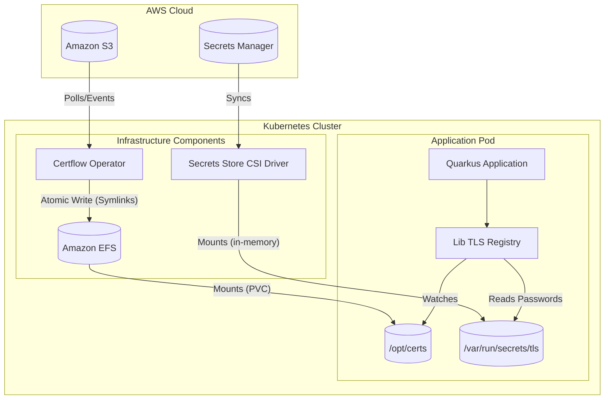

# Visão Geral da Arquitetura

O Certflow implementa uma arquitetura segura e resiliente para distribuição de certificados, separando armazenamento de artefatos e segredos.

## Diagrama de Componentes (C4 Container Level)

## Fluxo de Dados

1. **Artefatos**: O `Certflow Operator` monitora o S3. Ao detectar nova versão, baixa e escreve atomicamente no EFS.
2. **Segredos**: O `CSI Driver` sincroniza senhas do Secrets Manager e as expõe como arquivos em `/var/run/secrets/tls`.
3. **Aplicação**: A aplicação Quarkus (via `Lib TLS Registry`) observa mudanças no diretório de certificados. Quando ocorrem, ela recarrega as configurações SSL usando as novas senhas, sem reiniciar.
